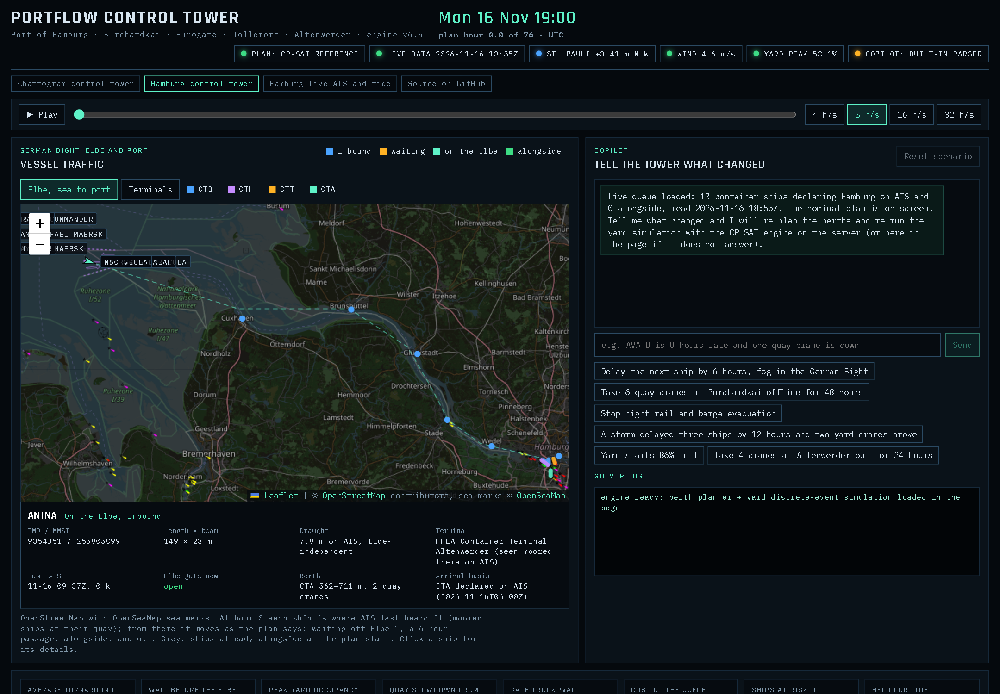
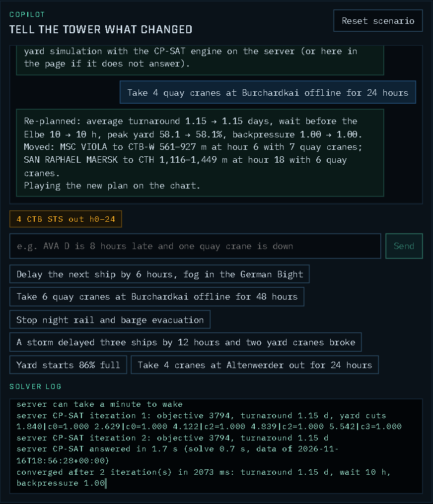

# PortFlow: live control towers for Chattogram and Hamburg with constraint programming and simulation

**Discipline:** Industrial and Production Engineering · operations research · discrete-event simulation · software engineering
**Role:** sole engineer · **Target roles:** R&D engineer, optimisation / OR engineer, simulation engineer, Industry 4.0 software engineer
**Stack:** Python · Google OR-Tools CP-SAT · SimPy · NumPy / SciPy · FastMCP · React · JavaScript · Leaflet · GitHub Actions · Render · pytest · Playwright · uv · Figma

> **In one line.** A pure-software digital twin of two container ports, Chattogram (New Mooring Container Terminal) and Hamburg. A constraint-programming planner decides berths, cranes and tide windows, a yard simulation corrects it through Benders cuts, and the whole thing re-plans every 4 hours on live AIS, port and tide data, with public control-tower pages and a copilot that runs the real engine on a server.

> **What kind of work this is.** Mathematical modelling, solver engineering, simulation and the code that couples them, run as a live service and tested like production software. No sensors, PLCs or hardware are involved: every input is a schedule, a tide forecast, a port list or an AIS message.

**Try it:** [Hamburg control tower](https://artahmid03-source.github.io/portflow-simopt-mcp/tower/hamburg.html) · [Chattogram control tower](https://artahmid03-source.github.io/portflow-simopt-mcp/tower/chattogram.html). Type a disruption into the copilot, for example "Take 4 quay cranes at Burchardkai offline for 24 hours".

| −34% turnaround | 62% peak yard | every 4 h | ~2 s copilot |
|---|---|---|---|
| Chattogram, 3.04 → 2.01 days | from 95.5%, below the 80% cliff | live re-plan, two ports | server CP-SAT re-plan |

---

## The engineering problem

A container ship's time in port depends on three coupled limits:

1. **Water.** A ship may cross the bar or sail the river only when the tide covers its draught plus clearance. At Chattogram large ships also need daylight; on the Elbe the widest ships may only pass each other in one stretch, and the biggest stop in strong wind.
2. **Quay cranes.** More cranes per ship shorten service, but only while the yard can absorb the boxes.
3. **The yard.** Past roughly 80% occupancy, yard cranes spend their time digging out buried boxes, trucks queue, and the quay stalls.

An optimiser that sees only the first two plans too many cranes into a yard that cannot take the boxes. A simulator sees the third but cannot plan. The project couples the two, and then runs the coupled model every few hours on live data.

## What I built

| Layer | Method | What I implemented |
|---|---|---|
| Berth and crane plan | CP-SAT constraint programming | 2-D no-overlap on the quay; crane modes as optional intervals on a cumulative crane pool per terminal; tide-legal entry and departure hours as variable domains; pilots and tugs as a cumulative resource; Elbe passing-box and wind rules; a cost objective in dollars |
| Yard response | SimPy discrete-event simulation | Night shift (off-dock evacuation, grooming) and a discharge wave sized to each ship; closed truck loop that blocks the quay when the yard is full |
| Coupling | Logic-based Benders decomposition | One slowdown cut per crane mode and ship size; the master's objective is a lower bound that rises to the optimum |
| Yard across days | Yard ledger | Hour-by-hour yard level over the whole plan, fed back into the planner until it settles |
| Live data | Ingestion pipeline | AIS collector, the Port of Hamburg's expected-vessel list, Elbe gauge tide forecasts, calibrated Chattogram sea level, wind |
| Learning | Backtest and ridge regression | Every plan compared with AIS moorings; a cross-validated arrival-time correction used only once it beats declared ETAs |
| Service | GitHub Actions, Render | Re-plan every 4 hours; a planning API for the copilot; an MCP server with 13 tools |
| Interface | React, Leaflet | Control towers on real maps, berth Gantt with tide, yard ledger, cost and tide-risk columns, a "why it waits" line per ship |

## The core contribution

CP-SAT proposes a plan assuming the yard never slows the quay. The simulator measures the slowdown β for each crane mode the plan uses; those measurements return as cuts and CP-SAT re-solves. Each solve is a relaxation, so its objective is a lower bound; when the plan uses only measured modes the bound is attained and the plan is optimal for the simulated yard. Cuts are keyed by crane mode and ship size class, the condition under which simulation-based Benders cuts are valid (Forbes et al., *EJOR* 2024).

## Results

**Chattogram snapshot study (13 Nov 2026, 8 ships).** Arrival order with every crane: 3.04 days, peak yard 95.5%, truck wait 1,882 min. PortFlow: **2.01 days (−34%)**, peak yard **62%**, truck wait **69 min**, reefer peak −20% with no cold-chain breach. Optimising berths alone gave 3%; the rest came from relieving the yard at night. The bottleneck was the yard, not the quay.

**Live towers.**

| Run | Ships | First come, first served → PortFlow | Notes |
|---|---:|---|---|
| Hamburg, 15 Nov 14:30 UTC | 11 | 1.42 → **1.22 days**, waiting 75 → 30 h | the port's own list added five ships |
| Hamburg, 16 Nov 18:56 UTC | 13 | 1.15 → 1.15 days; peak yard 81% → **58%** | a light day: the gain is in the yard |
| Chattogram, 13 Nov queue | 8 | no first-come plan fits; PortFlow 3.32 days | yard ledger peaks at 84%: realistic figure 4.25 days |

## Software engineering practice

- 104 automated tests plus four browser tests in CI on every push, including Python/JavaScript parity for the yard ledger and a server copilot test.
- Byte-reproducible snapshot pipeline, re-run and diffed in CI.
- Crane limit rewritten as a cumulative constraint: 80 s → 24 s with the same optima; cached yard simulations make a copilot command on a free host answer in about 2 seconds.

## Limitations

Box counts per call, yard capacities and dwell times, some crane counts and the Elbe thresholds are stated assumptions. Positions refresh in bursts rather than continuously. All results are inside the model: useful for comparing decisions, not a forecast.

**Links:** [GitHub](https://github.com/artahmid03-source/portflow-simopt-mcp) · [Hamburg tower](https://artahmid03-source.github.io/portflow-simopt-mcp/tower/hamburg.html) · [Chattogram tower](https://artahmid03-source.github.io/portflow-simopt-mcp/tower/chattogram.html) · [Planning API](https://portflow-api.onrender.com/health) · [Figma](https://www.figma.com/design/u2uDIWNSOxIM0IFEvztXZ8)
