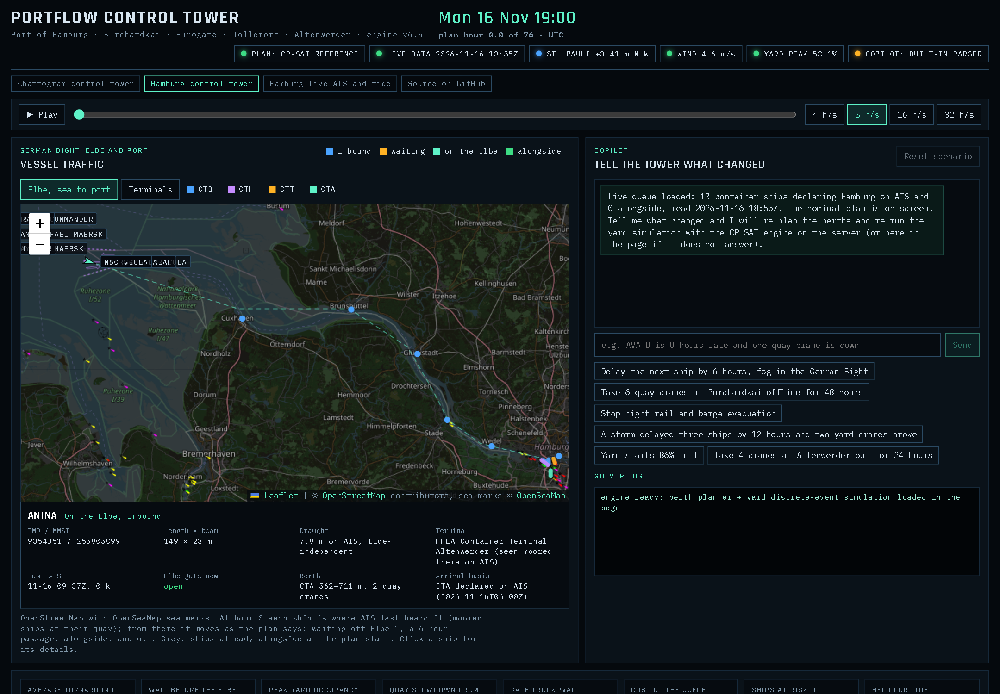
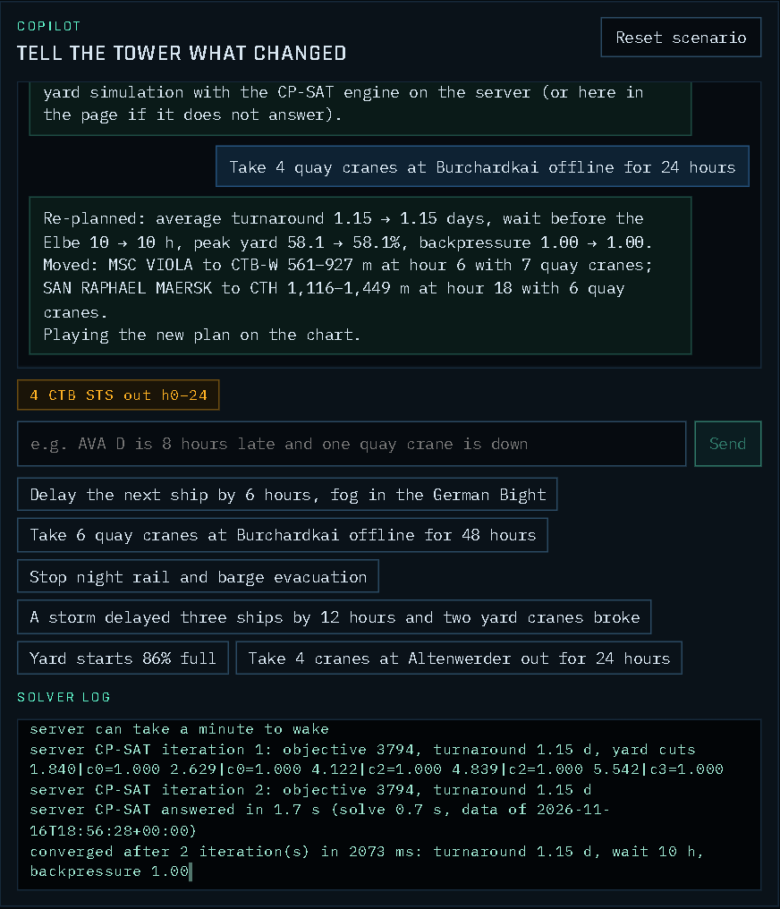
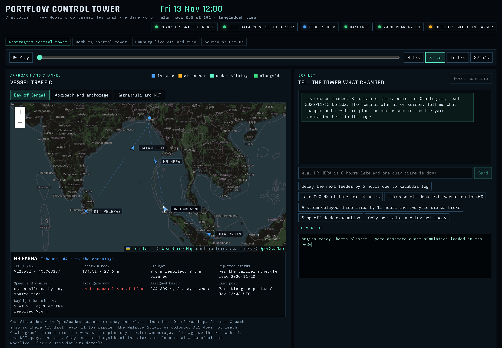
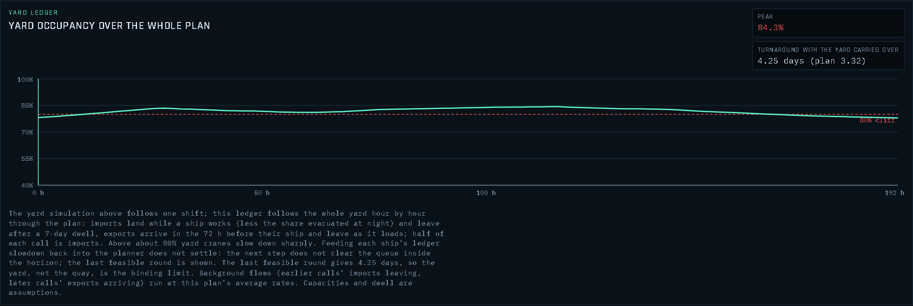
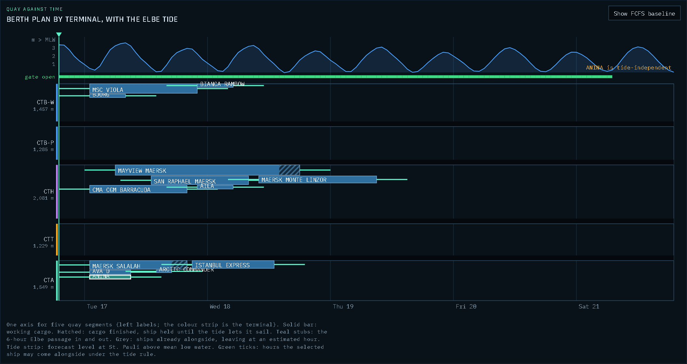
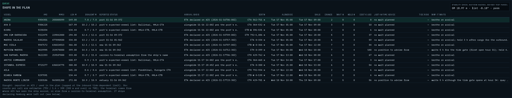
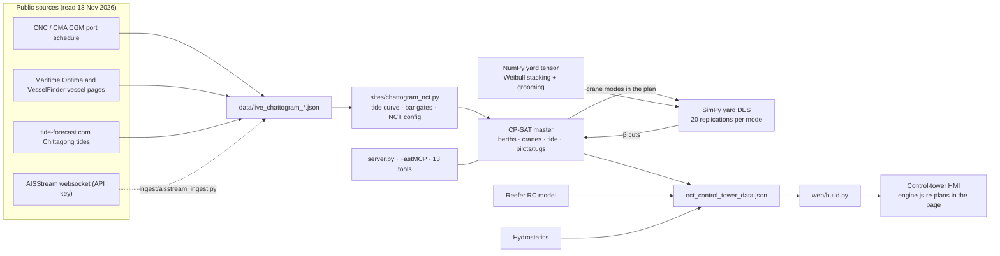
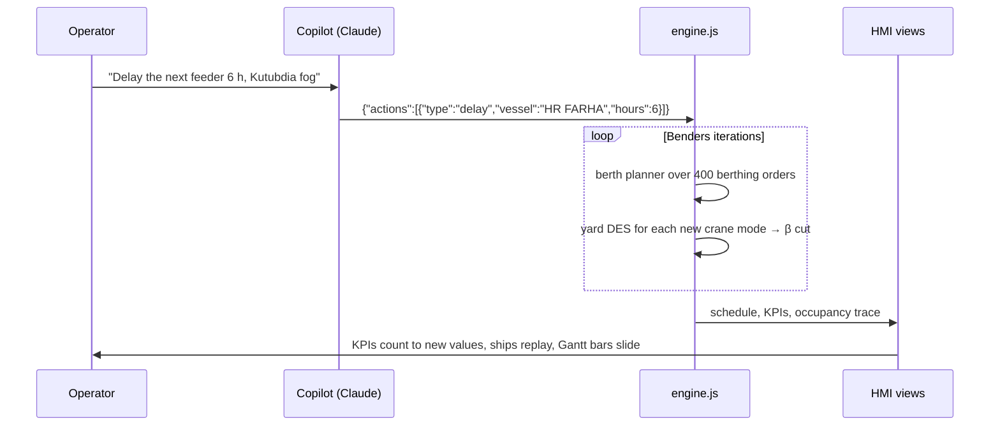
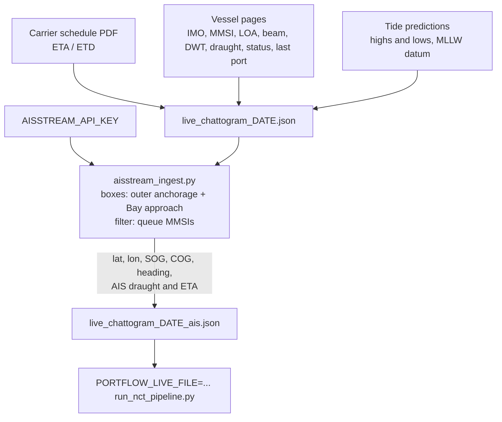

# PortFlow-SimOpt-MCP · Chattogram NCT and the Port of Hamburg


[](https://github.com/artahmid03-source/portflow-simopt-mcp/actions/workflows/ci.yml)
[](https://github.com/artahmid03-source/portflow-simopt-mcp/actions/workflows/collect.yml)
[](https://github.com/artahmid03-source/portflow-simopt-mcp/actions/workflows/daily.yml)


A simulation-optimisation digital twin of two container ports, **Chattogram (New Mooring Container Terminal, Bangladesh)** and **the Port of Hamburg**. It is pure software. A constraint-programming planner (OR-Tools CP-SAT) decides where and when each ship berths, how many quay cranes it gets, and when the tide (and at Chattogram, daylight) lets it cross the bar or sail the Elbe. A discrete-event simulation of the yard (SimPy) measures how much those cranes slow down once the yard fills. The two exchange logic-based Benders cuts until the plan is optimal for the yard it creates.

Every 4 hours, GitHub Actions re-plans both ports from live AIS ship positions, the Port of Hamburg's expected-vessel list, tide and wind forecasts, and compares earlier plans with what the ships actually did. The public control-tower pages show the plan on a real map, and their copilot sends typed disruptions to the same CP-SAT engine running on a server ([planning API](https://portflow-api.onrender.com/health)), with an in-browser planner as fallback. The engine is also served over the Model Context Protocol, so an AI assistant can call it.

> **Live control towers:** [Hamburg](https://artahmid03-source.github.io/portflow-simopt-mcp/tower/hamburg.html) · [Chattogram](https://artahmid03-source.github.io/portflow-simopt-mcp/tower/chattogram.html) · [Hamburg live AIS and tide forecast](https://artahmid03-source.github.io/portflow-simopt-mcp/) · **Design file:** [Figma](https://www.figma.com/design/u2uDIWNSOxIM0IFEvztXZ8)
>
> 

| | |
|---|---|
|  |  |
| **Copilot.** A typed crane outage re-planned by the CP-SAT engine on the server; the log shows each Benders iteration. | **Chattogram.** The 13 Nov queue on the Bay of Bengal map: ships from Singapore, the Malacca Strait and Colombo. |
|  |  |
| **Yard ledger.** The yard carried across the whole plan. At Chattogram it sits above 80%, so the realistic turnaround is 4.25 days, not 3.32. | **Berth plan.** Quay position against time per terminal, with the Elbe tide. |



### What the live towers show (examples)

| Run | Ships | First come, first served → PortFlow | Notes |
|---|---:|---|---|
| Hamburg, 15 Nov 14:30 UTC | 11 | 1.42 → **1.22 days**, wait before the Elbe 75 → 30 h | the port's own list added five ships |
| Hamburg, 16 Nov 18:56 UTC | 13 | 1.15 → 1.15 days; peak yard 81% → **58%**; queue cost 584k → 576k USD | a light day: the gain is in the yard, not in waiting |
| Chattogram, 13 Nov queue | 8 | no first-come plan fits the horizon; PortFlow 3.32 days | yard ledger peaks at 84%, so 4.25 days is the realistic figure |

The 13 Nov snapshot study below (one-off, with stated assumptions) is where the method was first validated.

---

## What it does

| Capability | Plain words | Method |
|---|---|---|
| Predicts yard gridlock | Plays the next days forward to see whether discharging fast will pack the yard past the point where yard cranes spend their time digging. | SimPy DES of a berth's yard cluster with a closed truck loop that blocks the quay; 20 replications per crane mode |
| Grooms stacks at night | Rearranges stacks during the quiet shift so boxes leaving first sit on top. | Weibull dwell-aware slotting on a 40 × 6 × 5 NumPy tensor, then greedy pre-marshalling that never moves dangerous goods |
| Berths ships only on enough water | Lets a ship enter or leave only in hours when the predicted tide covers its draught plus clearance, by daylight if it is large. | Tide-gated CP-SAT start/departure domains, 2-D no-overlap on the quay, cumulative pilot/tug resource |
| Shaves reefer peak power | Pre-cools refrigerated boxes so compressors can be capped in the 17:00–22:00 tariff window without any box warming past −18 °C. | Lumped RC thermal model; minimum compressor cap by bisection over 7 simulated days |

---

## Snapshot study: Chattogram queue of 13 Nov 2026, 12:00 Bangladesh time (v6.0)

Eight container ships: HAIAN ZETA and HR HERA at anchor; HR FARHA, KOTA DUNIA, CNC NEPTUNE, MTT PELEPAS, SINAR SABA and KOTA RAJIN inbound. SOL MALAYSIA is already alongside. Simulation figures are means of 20 replications.

| KPI | FCFS baseline¹ | CP-SAT + Benders, no off-dock relief | **CP-SAT + Benders + 33% ICD evacuation** | Change vs baseline |
|---|---:|---:|---:|---:|
| Average turnaround | 3.04 d | 2.95 d | **2.01 d** | −33.9% |
| Anchorage waiting (all ships) | 53 h | 35 h | **35 h** | −34.0% |
| Quay slowdown from the yard, β | 2.02 | 2.02 | **1.00** | −50.5% |
| Peak yard occupancy | 95.5% | 95.5% | **62.1%** | −33.4 pts |
| Gate truck wait | 1,882 min | 1,882 min | **69 min** | −96.3% |
| Unproductive rehandle crane time | 171 h | 171 h | **0 h** | eliminated |
| Held alongside for tide or daylight | 66 h | 25 h | 94 h | +42% (see note) |
| Fuel burned waiting, proxy² | 98.1 t | 64.8 t | **64.8 t** | −33.3 t |
| CP-SAT objective | 3,948 | 3,624 | **2,544** | −35.6% |

¹ Ships berth in arrival order, each with every crane it can take, no off-dock evacuation. ² 1.85 t of HFO per hour at anchor, a service-speed burn rate; read it as the upper bound of what Virtual Arrival slow-steaming could save.

**Bottleneck migration.** Optimising the berth plan alone buys 3% (3.04 → 2.95 days), because the yard is the constraint: at 78% starting occupancy the discharge wave pushes it to 95%, and every extra crane only fills it faster (β = 2.02). Evacuating a third of the boxes to off-dock depots during the night shift keeps the yard at 62%, β falls to 1.00, and the same CP-SAT plan delivers the remaining 31%. Ships then finish cargo sooner and wait alongside for a legal tide more often (94 h of holds), which is why holds rise while turnaround falls.

**Optimised berth plan**

| Vessel | Berth (m) | Alongside | Sails | Quay cranes | Moves³ | Wait (h) | Tide/daylight hold (h) |
|---|---:|---|---|---:|---:|---:|---:|
| HAIAN ZETA | 398–581 | Fri 13 Nov 14:00 | Sun 15 Nov 06:00 | 3 | 1,456 | 0 | 10 |
| HR HERA | 601–784 | Fri 13 Nov 15:00 | Sun 15 Nov 15:00 | 3 | 1,448 | 1 | 18 |
| KOTA DUNIA | 206–322 | Sat 14 Nov 14:00 | Sun 15 Nov 05:00 | 2 | 499 | 0 | 0 |
| HR FARHA | 0–185 | Sat 14 Nov 16:00 | Tue 17 Nov 06:00 | 3 | 1,497 | 9 | 31 |
| CNC NEPTUNE | 205–377 | Sun 15 Nov 16:00 | Tue 17 Nov 06:00 | 3 | 1,341 | 5 | 10 |
| MTT PELEPAS | 206–378 | Tue 17 Nov 10:00 | Thu 19 Nov 06:00 | 3 | 1,490 | 0 | 13 |
| KOTA RAJIN | 40–186 | Tue 17 Nov 20:00 | Wed 18 Nov 20:00 | 2 | 802 | 0 | 0 |
| SINAR SABA | 410–582 | Wed 18 Nov 08:00 | Fri 20 Nov 08:00 | 3 | 1,740 | 20 | 12 |

³ Estimated as 0.85 × deadweight / 14; box counts per call are not published.

**Other results**

| Item | Result |
|---|---|
| Stability, HAIAN ZETA with a 360-box parcel | KG 9.36 m, KM 10.79 m, **GM 1.44 m** (≥ 1.20), list **1.81°** (≤ 3.0) |
| Blocking boxes in one 40-bay block, 80% full | random 485 → dwell-aware 293 → **260 after 33 night moves** (−46%) |
| Off-dock evacuation | ≈ 1,325 boxes per berth-cluster cycle (logged run: 1,081 at night, 240 direct from quay) |
| Reefer power, 400 plugs | mean daily peak 1,351 → **1,080 kW** (−20.1%); 17:00–22:00 peak 1,395 → 1,065 kW (−23.7%); **0** breaches, warmest box −18.27 °C over 7 days |
| Pilot/tug sets (v6 upgrade) | 1 set: 2.62 d, 77 h waiting · 2 sets: 2.01 d · 3 sets: 2.01 d |
| Draught check | at the 9.5 m planning draught HR FARHA has 13 daylight bar windows and SINAR SABA 9; at their AIS-reported 9.6 m and 9.8 m each has one, on 21 Nov, because the spring tides end on 15 Nov |
| Night cut-off | moving the daylight-only cut-off from sunset (17:09) to 18:00 leaves the plan unchanged (2.01 d) |

---

## Architecture





---

## Chattogram NCT formulation

**Sets and data.** Vessels $v \in V$ with length $L_v$ (plus a 20 m gap), draught $d_v$, arrival hour $a_v$, moves $m_v$; hours $t \in \{0,\dots,H\}$, $H = 192$; crane counts $q \in \{1,\dots,\bar q_v\}$ ($\bar q_v = 3$ if LOA ≥ 160 m, else 2); predicted tide $h(t)$ in metres above MLLW; quay crane rate $p = 18.5$ moves/h; crane interference $e(q) = q^{0.88}$; transit time $T = 2$ h; pilot/tug sets $K = 2$; quay crane pool $C(t) = 14 - \text{out}(t)$.

**Bar gate.** Hour $t$ is legal for vessel $v$ when

$$
h(t) \ge d_v + u - D,\quad d_v \le 10.0,\quad \bigl(d_v \le 9.5 \ \lor\ h(t) \ge h_{\text{spring}}\bigr),\quad \bigl(t \in \mathcal{D} \ \lor\ (\text{LOA}_v \le 170 \land d_v \le 9.0)\bigr)
$$

with channel depth $D = 7.5$ m, under-keel clearance $u = 0.6$ m, spring threshold $h_{\text{spring}} = 3.0$ m and daylight hours $\mathcal{D} = [06{:}00, 17{:}00)$. $G_v$ is the set of legal hours.

**Variables.** Berth start $s_v$, berth position $x_v \in [0, 820 - L_v]$, mode booleans $y_{vq}$ with $\sum_q y_{vq} = 1$, cargo completion $c_v$, departure $\delta_v$.

**Constraints.**

$$
[s_v - T,\ s_v) \subseteq G_v,\qquad s_v \ge a_v + T,\qquad [\delta_v,\ \delta_v + T) \subseteq G_v,\qquad \delta_v \ge c_v
$$

$$
c_v = s_v + \sum_q y_{vq}\,\Bigl\lceil \frac{m_v\,\hat\beta_{e(q)}}{p\,e(q)} \Bigr\rceil
$$

$$
\textsf{NoOverlap2D}\bigl([x_v, x_v + L_v) \times [s_v, \delta_v)\bigr)\ \text{over } V \cup \{\text{ships already alongside}\}
$$

$$
\textsf{Cumulative}\bigl(\{[s_v - T, s_v),\ [\delta_v, \delta_v + T)\}_{v},\ \text{demand } 1,\ \text{capacity } K\bigr)\qquad\text{(v6: pilots and tugs on the river)}
$$

$$
\sum_{v}\sum_{q} q\,y_{vq}\,\mathbb{1}[s_v \le t < c_v] \le C(t)\quad \forall t
$$

The tide gates are encoded as CP-SAT domains (`NewIntVarFromDomain` over the legal start and departure hours), so illegal hours never enter the search.

**Objective.** $\min \sum_v 18\,(s_v - T - a_v) + 6\,(\delta_v - s_v)$: anchorage waiting costs three times as much as occupying the quay.

---

## Benders loop and why it converges

The master is the model above with $\hat\beta_k$ for each crane effect $k = e(q)$. The subproblem simulates a berth's yard cluster with discharge intensity $\iota_k = p\,k / 48$ at the scenario's ICD ratio and starting occupancy, and returns $\beta_k = \max\bigl(1,\ \text{realised} / \text{nominal discharge makespan}\bigr)$ averaged over replications.

1. **Relaxation.** $\beta_k \ge 1$ by construction and unsimulated modes use $\hat\beta_k = 1$, so every master solve is a relaxation of the problem with the simulated response, and its optimum $z^{(i)}$ is a lower bound on $z^\*$.
2. **Monotone bound.** A cut only lengthens service times, so the feasible set shrinks and $z^{(1)} \le z^{(2)} \le \dots$ (asserted in `tests/test_nct.py`).
3. **Finite termination.** There are finitely many crane effects (three here), and each iteration either adds a new cut or stops, so the loop ends within $|K| + 1$ iterations.
4. **Optimality at termination.** When the master's plan uses only simulated modes, its cost is evaluated with true $\beta$ values, so it equals the lower bound and the plan is optimal.

Observed bounds: optimised plan 2,544 → 2,544 (2 iterations); no-relief plan 2,544 → 3,624 → 3,624 (3 iterations).

**Scope of the guarantee.** Optimal relative to the simulated response: $\beta$ are sample means with fixed seeds, and the cut assumes a berth's slowdown depends on its own crane mode (each ocean berth has its own yard cluster of seven yard cranes).

**Why the cuts are valid (v6.4 onwards).** Since v6.4 the key of a cut is the pair (crane mode, ship size class), and the simulation is run for exactly that pair: the same discharge wave, crane intensity, starting yard level, evacuation share and outages. The response the cut stores is therefore a function of its key alone, so a cut can never remove a plan whose own simulated response it does not describe. This is the condition under which logic-based Benders cuts from a simulation stay valid (Forbes et al., *European Journal of Operational Research* 312(3), 2024: a cut must be implied by the simulated response of every master solution that maps to the same key). It is also why a cut keyed only by crane mode, as before v6.4, was not quite valid once ships of different sizes shared a mode: a 3,000-box call and a 500-box call stress the yard differently. The guarantee remains relative to the simulation, its seeds and its one-shift horizon.

**What the guarantee does not cover: the yard across days.** The simulation follows one shift starting from a given yard level, so it does not see that today's imports are still in the yard tomorrow. v6.5 adds a **yard ledger** (`advice.yard_ledger`): hour by hour over the whole plan, imports land while a ship works (less the share evacuated at night) and leave after the dwell time, exports arrive in the 72 h before their ship and leave as it loads, and background flows from calls outside the horizon run at the plan's average rates. Each ship's slowdown is then the yard-crane cycle at the ledger level while it works, relative to the cycle at 60%, on the same curve as the simulation (made continuous at the 78% knee). `run_tower.ledger_refine` feeds these per-ship slowdowns back into the planner (as extra cuts keyed by ship) with a damped step, until they stop moving. This is a **fixed-point heuristic, not an optimality proof**: the ledger is a deterministic flow model, and the loop can fail to settle when the yard sits well past the knee. On the test data Hamburg settles in two rounds (peak 76%, plan unchanged at 1.22 days); Chattogram does not settle (peak 84%: every damped step slows the ships further), and its last feasible round, 4.25 days against 3.32, is shown as the realistic figure together with the message that the yard, not the quay, is the binding limit.

---

## Live data and AIS ingestion



What was live on 13 Nov 2026: ship names, IMO and MMSI numbers, dimensions, deadweight, reported draught, navigation status and area, last port, carrier ETA/ETD, and the tide table. What was not: latitude, longitude, speed and course. The ship-tracking sites tried either put them behind a subscription or a bot check, and the port authority's terminal dashboard served 2025 snapshots. `ingest/aisstream_ingest.py` closes the gap with a free AISStream key. It subscribes to the outer-anchorage box `[[21.75, 91.65], [22.35, 91.85]]` and a Bay of Bengal approach box, filters on the queue's MMSIs, and folds the latest position, speed, course, AIS draught and ETA into a new dated file. For ships under way it recomputes hours-to-anchorage from distance and speed. Its parser is unit-tested offline.

---

## Specifications: what the model binds, and what public sources say

| Item | Bound in the model | Public source | Effect on this queue |
|---|---|---|---|
| Quay | 820 m ocean (4 berths) + 180 m barge | 1,000 m, 5 berths; the operator page names the Pangaon berth NCT-1 | — |
| Day limits | 200 m LOA, 9.5 m draught; 10.0 m on spring highs | 186 m LOA by day | no ship exceeds 185 m |
| Night (daylight-only rule) | > 170 m or > 9.0 m may not move 17:00–06:00 | 175 m at night; brief says 153–170 m, 18:00 | no ship lies between 153 and 170 m; an 18:00 cut-off gives the same plan |
| Quay cranes | 14 at 18.5 moves/h | 10 QGC + 1 mobile harbour crane | rate has no public source |
| Yard cranes | 28 RTG (7 per ocean berth), 12 straddle carriers | 23 RTG, 12 straddle carriers | — |
| Yard | 14 blocks × 40 × 6 × 5; 4,200 TEU per berth cluster | 292,287 m² | 14 × 1,200 slots = 16,800, not 28,000 TEU |
| Reefer plugs | 400 | 700 | — |
| Off-dock share | 33% | no public source found | — |
| Assumptions | channel depth 7.5 m, UKC 0.6 m, 2 pilot/tug sets, yard 78% full at start, spring threshold 3.0 m | — | each is a key in `sites/chattogram_nct.py` |

---

## The in-page engine

`web/src/engine.js` re-plans in the page so the copilot shows a new plan in about a second. It has three parts: a generator-based DES kernel running the same yard logic as the SimPy model; a berth planner using serial schedule generation over every berthing order within two places of arrival order (400 orders for eight ships); and the same Benders loop. It is a heuristic, checked against CP-SAT on eight reference cases:

| Case | CP-SAT | In-page | Gap |
|---|---:|---:|---:|
| nominal · HR FARHA +6 h · 6 QGC out 48 h · 3 RTG out 24 h · ICD 10% | identical | identical | 0.0% |
| ICD 0% | 3,624 | 3,462 | −4.5% |
| yard starts 86% | 3,060 | 3,156 | +3.1% |
| one pilot/tug set | 3,756 | 3,990 | +6.2% |

Gaps in both directions come from the JavaScript DES estimating slightly different β (2.006 against 2.022 with no relief), plus the bounded search. On a combined storm case (three ships 12 h late, a crane out, two yard cranes out, no evacuation) CP-SAT found a plan (2.89 d) that the in-page planner did not. The page says so and points to `nct_simulate_disruption` on the MCP server.

---

## Install and run

```bash
git clone https://github.com/artahmid03-source/portflow-simopt-mcp.git
cd portflow-simopt-mcp
uv sync --extra ais                  # Python 3.10+, OR-Tools, SimPy, FastMCP, websockets
uv run ruff check . && uv run pytest # lint, then 64 tests (about 2 minutes)
uv run python run_nct_pipeline.py    # plans the live queue, writes nct_control_tower_data.json (about 1 minute)

# optional: refresh positions from AIS (free key at https://aisstream.io)
export AISSTREAM_API_KEY=...
uv run python ingest/aisstream_ingest.py --minutes 10
PORTFLOW_LIVE_FILE=data/live_chattogram_<date>_ais.json uv run python run_nct_pipeline.py

# the control-tower page
cd web && npm ci && python build.py && node validate.mjs --check
npx playwright install chromium && node test_page.cjs   # asserted browser test
```

**Use it from Claude Desktop.** Add this to `claude_desktop_config.json` (Windows: `%APPDATA%\Claude\claude_desktop_config.json`) and restart Claude:

```json
{
  "mcpServers": {
    "portflow-simopt-engine": {
      "command": "uv",
      "args": ["--directory", "C:\\supply_chain_mcp\\portflow_v6", "run", "server.py"]
    }
  }
}
```

Tools include `nct_live_queue`, `nct_plan_live_queue`, `nct_simulate_disruption`, `run_logic_benders_simopt`, `run_simpy_terminal_simulation`, `optimize_3d_yard_and_reefers`, `generate_and_parse_baplie`, `optimize_rtg_predictive_maintenance` and `optimize_wind_aware_berth_plan` (13 in all).

---

## Repository layout

```text
portflow_mcp.py              engine: stowage/hydrostatics, yard tensor, reefer model, DES, CP-SAT, Benders, MCP tools
sites/chattogram_nct.py      NCT site model: config, tide curve, bar gates, pilot/tug CP-SAT plan, NCT tools
server.py                    MCP entry point (stdio)
data/live_chattogram_2026-11-13.json   the live queue and tides, with source and basis of every field
ingest/aisstream_ingest.py   AIS message parsing and one-off merge into the live file
ingest/collect.py            scheduled collector (runs hourly in GitHub Actions, writes to the data branch)
ingest/build_db.py           loads the collected store into SQLite
sites/tides.py               tide forecast from official gauge records (harmonic fit, surge carry-over, hold-out skill)
docs/index.html              public Hamburg live page (GitHub Pages); docs/sample_latest.json is its fallback sample
docs/tower/                  public control towers: hamburg.html, chattogram.html (load the daily tower.json; app.js is the page bundle)
sites/hamburg.py             Hamburg site model: quays from OSM outlines, terminal pools, Elbe tide rule, live input from AIS + gauges
sites/chattogram_live.py     Chattogram live input: AIS heard in Singapore/Malacca/Colombo, carrier schedule, calibrated Open-Meteo tide
run_backtest.py              plan against reality (Hamburg): archived plans vs AIS moorings, and the port's own list as a benchmark
sites/advice.py              cost of the queue, just-in-time speed and fuel, tide-window risk (mirrored in web/src/engine.js)
ingest/hamburg_expected.py   the Port of Hamburg's expected-vessel list (terminal, berth, time; from HVCC via hafen-hamburg.de)
deploy/                      always-on collector: Dockerfile, Windows Task Scheduler script, instructions
run_tower.py                 daily plan for one site → <store>/<site>/tower.json (CP-SAT + Benders + yard + reefer + reference cases)
run_daily.py                 daily Hamburg update: tide forecast for six Elbe gauges + vessel picture from the collected AIS
tools/compare_runs.py        compares two pipeline outputs (used by CI)
.github/workflows/           ci.yml (lint, tests, reproducibility, page builds and browser tests) · collect.yml (hourly AIS) · daily.yml (every 4 h: tide forecast, both towers' plans)
run_nct_pipeline.py          live-queue pipeline → nct_control_tower_data.json
tests/                       test_invariants.py (19) · test_nct.py (25) · test_ais_ingest.py (4) · test_collect.py (11) · test_tides.py (6) · test_chattogram_live.py (7) · test_hamburg.py (7) · test_realism.py (9)
web/                         HMI: src/engine.js, src/PortFlowControlTower.template.jsx, build.py, build_pages.py, validate.mjs, test_page.cjs, test_towers.cjs, fixtures/
docs/screenshots/            control-tower captures (Hamburg and Chattogram, v6.5)
```

---

## Continuous integration

Every push runs two jobs. **Engine:** `ruff`, the 88 tests, then the whole pipeline again, with the fresh output compared against the committed `nct_control_tower_data.json` (integers and structure exactly, floats to 1e-6). **Page:** build, the in-page engine against the eight CP-SAT reference cases (the five exact cases must stay exact, no gap above 7%), and a headless-browser test that types a command into the copilot and checks the re-plan lands on the CP-SAT result, then renders the Hamburg live page from a saved real data file, and finally builds both public tower pages and tests them with the live feed mocked: the Hamburg map, the terminal bands, a terminal crane outage re-planned in the page and checked against CP-SAT, the Chattogram live plan replacing the snapshot, and the fallback when the feed is missing.

## Second site: Hamburg

**Live page:** https://artahmid03-source.github.io/portflow-simopt-mcp/ (real map with the ships on the Elbe and in port, tide forecast; reads the file the daily job writes; OpenStreetMap base with OpenSeaMap sea marks, Leaflet vendored under `docs/vendor/`)

AISStream hears nothing at Chattogram or anywhere else in South Asia (measured 15 Nov 2026: 0 ships at six South Asian ports, against 266 at Hamburg, 369 at Antwerp and 477 at Rotterdam in the same 3.6 minutes). The live loop therefore runs on the Port of Hamburg, a river port 100 km up the tidal Elbe, while Chattogram stays as the planning case study above.

What runs today:

- **Hourly AIS collection** for the German Bight, the Elbe and the port: cargo ships of 100 m or more, plus every such ship in the Channel and North Sea that declares Hamburg as destination.
- **Daily tide forecast** (`run_daily.py`, `sites/tides.py`) from 31 days of measured water levels at six official Elbe gauges (PEGELONLINE, the German waterway authority's open service). A 16-constituent harmonic model is fitted by robust least squares, and the surge observed over the last tidal day is carried forward with a 48-hour decay.

Forecast skill on the record of 15 Oct to 15 Nov 2026 (RMSE by lead time, forecasts started every 12 hours over the last 10 days):

| Gauge | Elbe km | 6 h | 24 h | 96 h |
|---|---:|---:|---:|---:|
| Cuxhaven | 724 | 13 cm | 19 cm | 47 cm |
| Brunsbüttel | 695 | 16 cm | 22 cm | 50 cm |
| Glückstadt | 674 | 18 cm | 23 cm | 51 cm |
| Stadersand | 655 | 21 cm | 24 cm | 52 cm |
| Schulau | 641 | 22 cm | 25 cm | 52 cm |
| Hamburg St. Pauli | 623 | 24 cm | 26 cm | 55 cm |

High-water times are predicted to within 6 to 9 minutes on a 7-day hold-out; heights are off by about 40 cm without the surge term, because autumn wind set-up on the German Bight is not tidal. The tidal range is 3.8 m at Cuxhaven and 4.7 m at St. Pauli, so a berth plan must carry a height margin that grows with lead time.

### The Hamburg control tower (`sites/hamburg.py`, `run_tower.py --site hamburg`)

Every day the same CP-SAT + yard-simulation loop as Chattogram plans the ships declaring Hamburg on AIS, and the page at `docs/tower/hamburg.html` loads the result.

- **Quays.** Five quay segments on four terminals (Burchardkai on two basins, Eurogate, Tollerort, Altenwerder), traced along the water side of the OpenStreetMap terminal outlines. Their lengths come out at 2,742 m for Burchardkai, 2,081 m for Eurogate, 1,229 m for Tollerort and 1,549 m for Altenwerder, close to the operators' published figures. The planner places them on one axis with gaps, so each ship's berth is a union of intervals in CP-SAT, and each terminal has its own quay-crane pool (HHLA's published counts; Eurogate's is an assumption).
- **Ships alongside** at the plan start come from AIS: a moored ship within 160 m of a quay line is placed on that segment at its projected position. The AIS antenna is not at the hull's centre, so neighbours are packed apart by the berth gap. Their departure is estimated from their size.
- **Terminal of an inbound ship:** where AIS has seen it moored before, otherwise a carrier-to-terminal map (Hapag-Lloyd's *... Express* ships to Altenwerder, COSCO to Tollerort, Maersk to Eurogate, the rest to Burchardkai). Cargo ships with no carrier name that have never been seen at a container quay are left out and listed.
- **The Elbe tide rule.** Since the 2019-2022 deepening, a ship of up to 13.80 m (13.10 m for the largest class) sails at any state of tide; deeper ships ride the tide up to 16.10 m inbound and 14.80 m outbound (15.40 / 14.10 m), less 0.20 m because the channel does not yet give the full design depth. A tide-dependent ship needs, at every hour it spends between Waltershof and Brunsbüttel, the forecast level at its position (interpolated between the six gauges by Elbe kilometre) above mean low water by its extra draught plus the forecast error at that lead time (18 cm at 6 h, 35 cm at 48 h). The planner reads the result as hour masks.
- **Map.** Both tower pages draw the plan on OpenStreetMap (Chattogram: sea routes, outer anchorage, the Karnaphuli river line and the NCT quay traced from OpenStreetMap). For Hamburg: ships start where AIS last heard them, wait off Elbe-1, sail the six-hour passage, lie at their quay and leave.

On the 15 Nov 2026 data (6 ships declaring Hamburg, 8 alongside), the plan is uncongested: every ship berths on arrival, and only the 399 m MAYVIEW MAERSK at 14.5 m is tide-dependent; it is held 2 h for the tide. The baseline and the optimised plan coincide, which is the correct answer for a quiet day. The copilot stresses it (crane outages per terminal, delays, the yard level), and the in-page planner matched CP-SAT exactly on 6 of 7 reference cases.

## Chattogram on live data (`sites/chattogram_live.py`, `run_tower.py --site chattogram`)

AISStream has no receiver near Chattogram, so the Chattogram tower is fed from three other free sources, every day:

- **Ships, from AIS heard elsewhere.** The collector's third connection reads static data across the sea from Sri Lanka to the South China Sea (`[[0.5, 78], [19.5, 105]]`), keeps cargo ships that declare Chattogram as their destination, and then follows them by MMSI while Singapore, the Malacca Strait, Port Klang and Colombo can hear them. The declared ETA is used; when it is missing or stale, the arrival is dead-reckoned along the sea route (Malacca Strait, the Great Channel, or round Dondra Head from Colombo) at the last reported speed. Ships longer than the NCT limit are left out as probable bulk carriers for the outer anchorage.
- **Ships, from the carrier schedule.** Ships on the 13 Nov carrier schedule whose ETA is still ahead and that AIS has not picked up.
- **Tide, from a global model calibrated to the port.** Open-Meteo's marine API (free, no key) gives an hourly sea-level forecast for the grid cell off the Karnaphuli mouth. A linear map and a 0.65 h lag, fitted to the 35 published highs and lows of 13-23 Nov 2026, convert it to the Chittagong chart datum: RMSE 0.11 m over the 35, 0.20 m when fitted on the first half and tested on the second. The bar gates keep a 0.11 m margin for that error. If the API is down, a five-constituent harmonic fit (M2, S2, K1, O1, M4) to the same table is used instead, and every day the two are compared (0.17 m RMS apart over the first plan). Sunrise and sunset are computed for the plan date, so the daylight rule follows the season.

On the 13 Nov epoch with the calibrated tide, the eight-ship queue needs 2.82 days of average turnaround against 2.01 days on the published table: the tide gates fall during the neap days of 16-19 Nov, holding ships for 177 hours in all. No first-come-first-served plan fits the eight-day horizon at all; that alone shows why the tide has to be inside the optimisation.

## v6.4: more realistic, faster, more useful

A review of the running system and of the literature (16 Nov 2026) found two data problems and several shortcuts. What changed:

**Data and rules**
- **The Port of Hamburg's own plan.** `ingest/hamburg_expected.py` reads the public expected-vessel list (next two days; terminal, berth, time, draught, size; from the Hamburg Vessel Coordination Center) every half hour. Its terminal and time replace the carrier-to-terminal guess, and feeders that never declared Hamburg on AIS now enter the plan. On the 15-16 Nov data this added five ships and moved ISTANBUL EXPRESS's arrival by a day.
- **Elbe rules.** Ships whose combined beam exceeds 90 m may meet only in the Wedel-Blankenese passing box and above 104 m not at all (a CP-SAT domain on the offset between one ship's inbound and the other's outbound passage; the box corresponds to a 5 h offset). Ships over 330 m or 45 m wide do not move at 13.9 m/s wind or more (hourly wind forecast). Ships wider than 51 m are not guessed into Altenwerder, which lies beyond the Köhlbrand bridge. The three thresholds are labelled assumptions.
- **Chattogram rules brought up to date.** 10.0 m draught and 200 m length (regular since early 2023), and river movements only from 5 h before to 1 h after each predicted high water. Schedule ships whose ETA has passed are no longer assumed to wait at anchor.
- **Chattogram's official due list.** The port authority publishes "vessels due at outer anchorage", but its portal forbids automated fetching (robots.txt) and its certificate is not trusted by common browsers, so the list is entered by hand into `data/chattogram_due.csv` and used while it is under three days old. AIS still hears no ship declaring Chattogram (0 in the first three runs).
- **Yard simulation per ship size.** The discharge wave is now sized to the ship (500, 1,000, 2,000 or 3,000 boxes by size class) instead of always 750, gate pickups scale with it, and a yard full for 48 h sends boxes to overflow instead of stalling the simulation. Cuts are keyed by crane mode and size class.

**Plan against reality**
- Every plan is archived (`<site>/plans/DATE` + `Thh.json`; since v6.5 a new plan every 4 hours, and the backtest scores the first plan of each day). `run_backtest.py` matches each planned ship with the time AIS first saw it moored at a container quay, and reports the mean and 90th-percentile error, the bias and how often the terminal was right, for PortFlow's plan and for the port's own list. Once 12 calls are matched, the arrival-error model used for the tide-window risk is fitted from them. The page shows the table.

**Faster**
- The crane limit is now a cumulative constraint over one optional working interval per crane option, instead of a yes/no variable per ship and hour. The Chattogram snapshot pipeline went from about 80 s to 24 s with the same optimal objective in every case (one alternative optimum for the plan-only case).
- Yesterday's plan warm-starts CP-SAT; the daily job runs CP-SAT on 4 threads and the simulation replications in 4 processes (`PORTFLOW_CPSAT_WORKERS`, `PORTFLOW_PROCS`; the reproducibility check keeps 1).
- The collector listens 12 minutes every half hour and has an always-on mode (`--cycles 0 --git-push`, Docker or Windows Task Scheduler in `deploy/`).
- The page re-plans in a Web Worker, so it keeps animating; the in-page planner also tries the most constrained ships first and a fixed set of shuffles, which made it exact on 6 of 7 Hamburg cases.

**More useful**
- **Cost objective.** Live plans minimise money: each ship's waiting and time alongside at an estimated charter rate (90 × TEU^0.68 USD/day) plus idle fuel at anchor.
- **Just-in-time speed advice.** For a ship with an AIS position and a planned wait, the slower speed that reaches the passage in time and the fuel and CO₂ it saves (fuel per mile ∝ speed²; IMO's containership study found 4-14% voyage savings).
- **Tide-window risk.** For each ship, the probability of missing the tide window the plan relies on, and how long the next window is.

## v6.5: the engine behind the page, a yard that carries over, and learned arrival times

**Server-side copilot.** `api/app.py` serves the real engine (CP-SAT berth plan, yard-simulation cuts, Benders loop) over HTTP: `POST /plan {"site", "scenario"}` takes the page's scenario, clamps it, loads that day's `tower.json` from the data branch (cached ten minutes), warm-starts from the daily plan and returns the plan in the shape the page's own planner returns. When the page has an API address (`web/api_url.txt` at build time, or `?api=<url>`; `?api=off` disables it), every copilot command goes to the server first; the log shows each server iteration, the plan lamp reads SERVER CP-SAT RE-PLAN, and the page falls back to the in-browser planner if the server is unreachable, busy (one job at a time, HTTP 429) or takes more than 100 s (a free host that has gone to sleep takes about a minute to wake). CP-SAT is capped at 20 s and one thread there, with four simulation replications; yard simulations are cached per day's data and reused whenever a scenario leaves the yard inputs unchanged (crane outages and delays do), and the nominal plans are run once at start-up, so on a free host a typical command takes seconds once the server is awake. The live deployment is https://portflow-api.onrender.com (`/health`). Deployment: `api/Dockerfile` and a Render blueprint (`render.yaml`, free plan). A browser test (`web/test_api.cjs`) starts the API locally and checks that a terminal-outage command comes back from the server with the CP-SAT reference result.

**Yard ledger.** See *Benders loop and why it converges* above. The page draws the ledger for the plan on screen (per terminal at Hamburg) with the 80% line, and the "Why it waits" column says, per ship, whether it waits for the tide gate, for quay space, cranes or passage slots, and whether it is held after cargo for the outbound tide. Python and the page compute both identically; CI checks it.

**Learned arrival times.** The collector now logs every ETA a ship declares on AIS with the time it was heard (`<site>/eta_log.jsonl`). `run_eta_model.py` (daily) matches each logged ETA with the call AIS later saw and fits a small ridge regression of the error on lead time, lead time squared and ship length, with 5-fold cross-validation. The Hamburg plan applies the correction only when the model has at least 20 matched calls and beats the declared ETAs by 10% or more out of sample; until then the ship's basis says "ETA declared on AIS", and afterwards it states the correction and the error before and after.

## Keeping it running: health checks, self-healing and alerts

The live system has five moving parts (the AIS collector, the 4-hourly planning run, the outside data sources, the planning API and the pages), and any of them can fail for reasons outside the code: GitHub skips scheduled runs under load, AISStream times out connections, a port website is down, a free host is asleep. Since v6.6 these are handled as normal events rather than errors:

| What can go wrong | What happens now |
|---|---|
| A data source is down (port list, tide gauges, wind, carrier schedule) | Each input step may fail on its own; the plan uses the last good copy, and the health check reports the age of each source. |
| AISStream times out a connection | The three connections start a few seconds apart, wait 30 s for the handshake and retry with jittered backoff; time offline is logged per run. |
| GitHub skips scheduled runs | The collector is scheduled every 15 minutes, the planning run listens to AIS for 8 minutes before it plans, and the health check restarts a collector that is more than 90 minutes stale or a plan more than 5 hours stale (at most once per 2 hours each, never while one is running). |
| Two runs push to the data branch at once | `tools/push_store.sh` rebases and retries up to six times. |
| A live run finds no ship (Chattogram) | Pages show the last plan that had ships, or the saved 13 Nov plan, with a note that says why. |
| Ships moored between sparse AIS reports | A ship heard moored at a container quay within 48 h stays alongside until its estimated working time runs out, and is then counted as sailed rather than as a new arrival. The backtest no longer scores a plan against a call that began before the plan was made. |
| The planning API is asleep | The planning run wakes it after each plan; the page waits up to 100 s and otherwise re-plans in the browser. |
| GitHub disables schedules after 60 quiet days | The health workflow makes an empty "keepalive" commit on `main` after 45 days without one. |
| Something stays broken | `.github/workflows/health.yml` runs after every collector and planning run and hourly. It writes `status.json` (the tower pages show it as the PIPELINE lamp), and when a check fails twice in a row it opens a "PortFlow health alert" issue that mentions the owner, so GitHub sends an email; it closes the issue when everything passes again. |

`python tools/health.py --store store` prints the same report locally.

**Chattogram's live queue** needs a source that is not AIS (no receiver reaches the Bay of Bengal) and not the port authority's portal (automated fetching is not allowed). `ingest/carrier_schedule.py` reads the DCSA Commercial Schedules `port-schedules` endpoint that Maersk publishes. It switches on when the repository secret `MAERSK_CONSUMER_KEY` exists (a self-service key from developer.maersk.com); until then the health check lists it as not set up. Ship sizes are not in that schedule, so a typical feeder size is assumed and labelled. The hand-entered due list (`data/chattogram_due.csv`) remains the other option.

## Continuous AIS collection

AIS is the one input that cannot be fetched after the fact, so it is collected on a timer. `.github/workflows/collect.yml` runs `ingest/collect.py` twice an hour (scheduled; GitHub skips some runs) for twelve minutes and commits what it heard to the `data` branch as plain text. The plans are rebuilt every 4 hours from whatever has been collected.

**Always-on listening.** `deploy/` runs the collector around the clock (Docker, or Windows Task Scheduler on a PC that stays on). A November 2026 survey of free hosts found none that runs a 24/7 background process without a payment card: Render, Koyeb, Zeabur and similar free tiers sleep or scale to zero, Fly.io and Heroku no longer have free tiers, and AWS and Azure free VMs expire. The two permanent free virtual machines, Google Cloud's e2-micro (US regions, 1 GB) and Oracle Cloud Always Free (cut to 2 Arm cores and 12 GB in June 2026; Oracle may reclaim VMs that stay under 20% load for a week, which an idle listener would), both need a card on sign-up. The e2-micro is the better fit for the collector.


| File | Contents |
|---|---|
| `positions/YYYY-MM-DD.jsonl` | time, MMSI, position, speed, course, heading, navigation status, zone. One row per ship per run; a ship that has not moved is re-logged only every 6 hours. |
| `static/YYYY-MM-DD.jsonl` | name, IMO, type, size, draught, declared destination and ETA, written when a ship changes them |
| `tracked.json` | ships that have declared the site's port as their destination in the last 14 days |
| `runs.jsonl` | messages heard, ships seen and errors for every run: the coverage log |
| `tower.json` | the latest control-tower plan (rewritten every 4 hours) |

Files live under `hamburg/` and `chattogram/` on the `data` branch. Three connections run side by side (AISStream allows three per key). One listens to the port and its approaches. The second first reads static data across the wider sea region to find cargo ships declaring the port as destination, then re-subscribes with an MMSI filter to follow only those. The third does the same for Chattogram (`--also chattogram`). The site (boxes, destination pattern, zones) is one entry in `ingest/collect.py`. Tide predictions are not collected because they can be looked up for any past date.

Setup: create a free key at aisstream.io and add it as the repository secret `AISSTREAM_API_KEY`. Without the secret the job skips with a warning. To analyse:

```bash
git clone -b data --single-branch https://github.com/artahmid03-source/portflow-simopt-mcp.git store
uv run python ingest/build_db.py --store store --db portflow.sqlite
```

The collector is tested offline against a stand-in server that follows the AISStream documentation. The first run (15 Nov 2026) heard no ships in the Chattogram box, so the collector now also measures coverage at a list of candidate ports; the live loop and the backtest will run on a port where AIS is actually received.

## Limitations

- The 13 Nov snapshot had no positions, speeds or courses. The daily Chattogram plan has them only where AIS hears the ships (Singapore, Malacca, Colombo); arrival there is dead-reckoned or taken from the declared ETA.
- Hamburg: terminal assignment of inbound ships, the departure of ships already alongside, Eurogate's crane count and all yard figures are estimates or assumptions; the Elbe tide rule is a simplification of the pilots' tide windows, applied over Waltershof to Brunsbüttel only.
- Chattogram's calibrated tide misplaces low water by about 50 minutes (the model's lows come early); one lag for both highs and lows is the simplest map that fits.
- Box counts per call, the starting yard level, channel depth, clearance and pilot/tug capacity are assumptions, and the terminals of the ships are not published. Every ship in the queue is treated as an NCT call.
- The 33% off-dock share and the 18.5 moves/h crane rate come from the project brief, not from a public source.
- The yard congestion curve has an assumed shape, and each berth's yard cluster is simulated separately.
- Tide heights are on the MLLW datum of tide-forecast.com. A second source gives highs about 0.6 m greater with no stated datum, and the choice moves the bar gates.

## References

- M. Forbes et al. (2024). Combining optimisation and simulation using logic-based Benders decomposition. *European Journal of Operational Research* 312(3), 840–854 (arXiv:2107.08390).
- J. N. Hooker and G. Ottosson (2003). Logic-based Benders decomposition. *Mathematical Programming* 96(1), 33–60.
- C. Bierwirth and F. Meisel (2015). A follow-up survey of berth allocation and quay crane scheduling problems in container terminals. *European Journal of Operational Research* 244(3), 675–689.

MIT licence.
