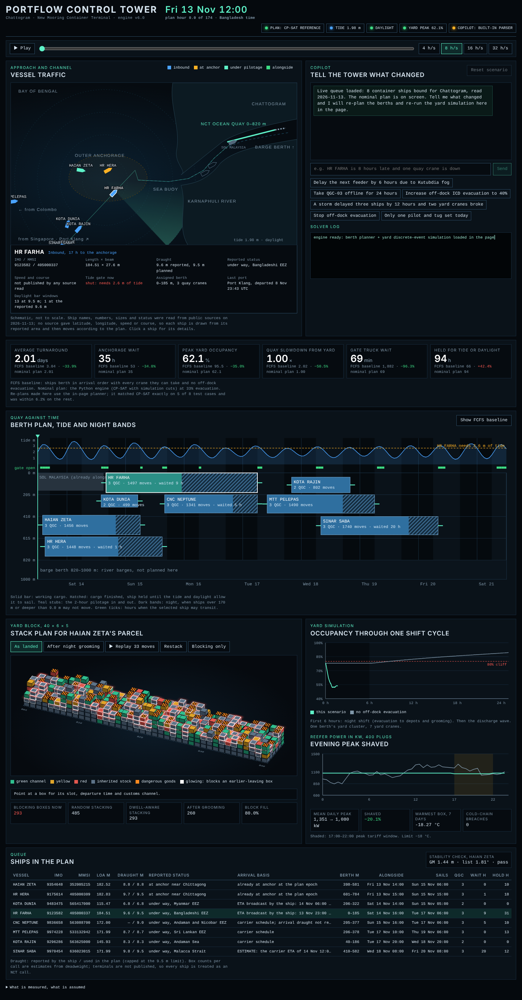
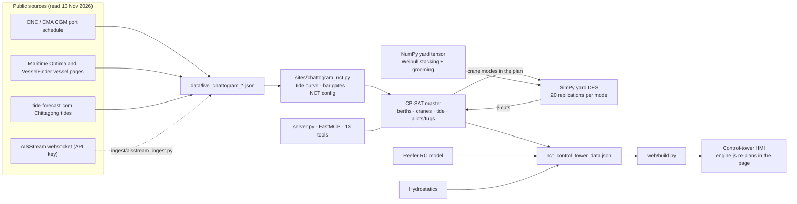
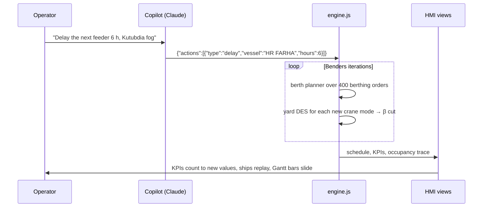
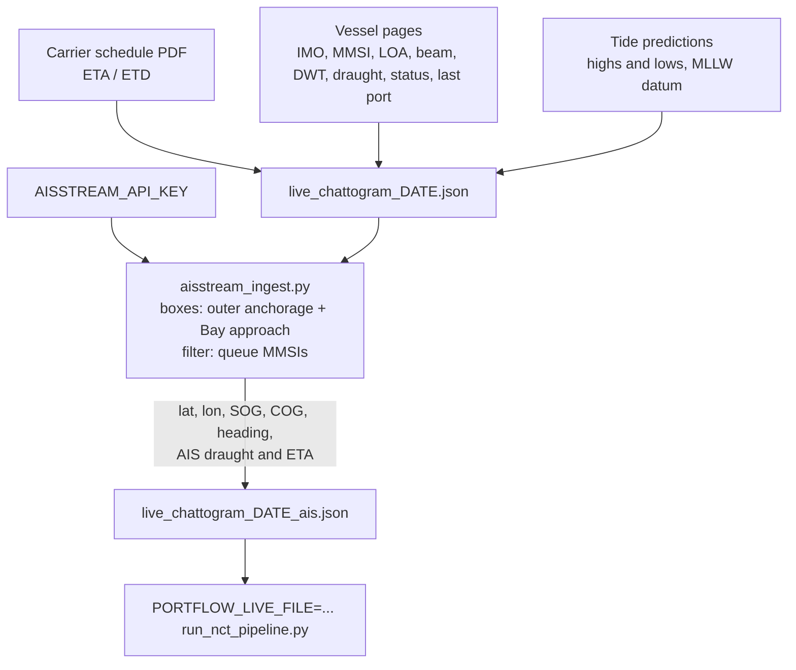

# PortFlow-SimOpt-MCP · Chattogram NCT


[](https://github.com/artahmid03-source/portflow-simopt-mcp/actions/workflows/ci.yml)
[](https://github.com/artahmid03-source/portflow-simopt-mcp/actions/workflows/collect.yml)


A simulation-optimisation digital twin of the **New Mooring Container Terminal (NCT), Chattogram, Bangladesh**, planned against the ships actually bound for the port on 13 November 2026. It is pure software. A constraint-programming planner (OR-Tools CP-SAT) decides where and when each ship berths, how many quay cranes it gets, and when the Karnaphuli tide and daylight let it cross the bar. A discrete-event simulation of the yard (SimPy) measures how much those cranes slow down once the yard fills. The two exchange logic-based Benders cuts until the plan is optimal for the yard it creates.

The engine is served over the Model Context Protocol, so an AI assistant can call it. A control-room web page carries a JavaScript port of the planner and simulator, so it can re-plan a typed disruption on the spot.

> **Live HMI:** `<add the share link of the PortFlow Control Tower artifact>` · **Design file:** [Figma](https://www.figma.com/design/u2uDIWNSOxIM0IFEvztXZ8)
>
> 

---

## What it does

| Capability | Plain words | Method |
|---|---|---|
| Predicts yard gridlock | Plays the next days forward to see whether discharging fast will pack the yard past the point where yard cranes spend their time digging. | SimPy DES of a berth's yard cluster with a closed truck loop that blocks the quay; 20 replications per crane mode |
| Grooms stacks at night | Rearranges stacks during the quiet shift so boxes leaving first sit on top. | Weibull dwell-aware slotting on a 40 × 6 × 5 NumPy tensor, then greedy pre-marshalling that never moves dangerous goods |
| Berths ships only on enough water | Lets a ship enter or leave only in hours when the predicted tide covers its draught plus clearance, by daylight if it is large. | Tide-gated CP-SAT start/departure domains, 2-D no-overlap on the quay, cumulative pilot/tug resource |
| Shaves reefer peak power | Pre-cools refrigerated boxes so compressors can be capped in the 17:00–22:00 tariff window without any box warming past −18 °C. | Lumped RC thermal model; minimum compressor cap by bisection over 7 simulated days |

---

## Results on the live queue (13 Nov 2026, 12:00 Bangladesh time)

Eight container ships: HAIAN ZETA and HR HERA at anchor; HR FARHA, KOTA DUNIA, CNC NEPTUNE, MTT PELEPAS, SINAR SABA and KOTA RAJIN inbound. SOL MALAYSIA is already alongside. Simulation figures are means of 20 replications.

| KPI | FCFS baseline¹ | CP-SAT + Benders, no off-dock relief | **CP-SAT + Benders + 33% ICD evacuation** | Change vs baseline |
|---|---:|---:|---:|---:|
| Average turnaround | 3.04 d | 2.95 d | **2.01 d** | −33.9% |
| Anchorage waiting (all ships) | 53 h | 35 h | **35 h** | −34.0% |
| Quay slowdown from the yard, β | 2.02 | 2.02 | **1.00** | −50.5% |
| Peak yard occupancy | 95.5% | 95.5% | **62.1%** | −33.4 pts |
| Gate truck wait | 1,882 min | 1,882 min | **69 min** | −96.3% |
| Unproductive rehandle crane time | 171 h | 171 h | **0 h** | eliminated |
| Held alongside for tide or daylight | 66 h | 25 h | 94 h | +42% (see note) |
| Fuel burned waiting, proxy² | 98.1 t | 64.8 t | **64.8 t** | −33.3 t |
| CP-SAT objective | 3,948 | 3,624 | **2,544** | −35.6% |

¹ Ships berth in arrival order, each with every crane it can take, no off-dock evacuation. ² 1.85 t of HFO per hour at anchor, a service-speed burn rate; read it as the upper bound of what Virtual Arrival slow-steaming could save.

**Bottleneck migration.** Optimising the berth plan alone buys 3% (3.04 → 2.95 days), because the yard is the constraint: at 78% starting occupancy the discharge wave pushes it to 95%, and every extra crane only fills it faster (β = 2.02). Evacuating a third of the boxes to off-dock depots during the night shift keeps the yard at 62%, β falls to 1.00, and the same CP-SAT plan delivers the remaining 31%. Ships then finish cargo sooner and wait alongside for a legal tide more often (94 h of holds), which is why holds rise while turnaround falls.

**Optimised berth plan**

| Vessel | Berth (m) | Alongside | Sails | Quay cranes | Moves³ | Wait (h) | Tide/daylight hold (h) |
|---|---:|---|---|---:|---:|---:|---:|
| HAIAN ZETA | 398–581 | Fri 13 Nov 14:00 | Sun 15 Nov 06:00 | 3 | 1,456 | 0 | 10 |
| HR HERA | 601–784 | Fri 13 Nov 15:00 | Sun 15 Nov 15:00 | 3 | 1,448 | 1 | 18 |
| KOTA DUNIA | 206–322 | Sat 14 Nov 14:00 | Sun 15 Nov 05:00 | 2 | 499 | 0 | 0 |
| HR FARHA | 0–185 | Sat 14 Nov 16:00 | Tue 17 Nov 06:00 | 3 | 1,497 | 9 | 31 |
| CNC NEPTUNE | 205–377 | Sun 15 Nov 16:00 | Tue 17 Nov 06:00 | 3 | 1,341 | 5 | 10 |
| MTT PELEPAS | 206–378 | Tue 17 Nov 10:00 | Thu 19 Nov 06:00 | 3 | 1,490 | 0 | 13 |
| KOTA RAJIN | 40–186 | Tue 17 Nov 20:00 | Wed 18 Nov 20:00 | 2 | 802 | 0 | 0 |
| SINAR SABA | 410–582 | Wed 18 Nov 08:00 | Fri 20 Nov 08:00 | 3 | 1,740 | 20 | 12 |

³ Estimated as 0.85 × deadweight / 14; box counts per call are not published.

**Other results**

| Item | Result |
|---|---|
| Stability, HAIAN ZETA with a 360-box parcel | KG 9.36 m, KM 10.79 m, **GM 1.44 m** (≥ 1.20), list **1.81°** (≤ 3.0) |
| Blocking boxes in one 40-bay block, 80% full | random 485 → dwell-aware 293 → **260 after 33 night moves** (−46%) |
| Off-dock evacuation | ≈ 1,325 boxes per berth-cluster cycle (logged run: 1,081 at night, 240 direct from quay) |
| Reefer power, 400 plugs | mean daily peak 1,351 → **1,080 kW** (−20.1%); 17:00–22:00 peak 1,395 → 1,065 kW (−23.7%); **0** breaches, warmest box −18.27 °C over 7 days |
| Pilot/tug sets (v6 upgrade) | 1 set: 2.62 d, 77 h waiting · 2 sets: 2.01 d · 3 sets: 2.01 d |
| Draught check | at the 9.5 m planning draught HR FARHA has 13 daylight bar windows and SINAR SABA 9; at their AIS-reported 9.6 m and 9.8 m each has one, on 21 Nov, because the spring tides end on 15 Nov |
| Night cut-off | moving the daylight-only cut-off from sunset (17:09) to 18:00 leaves the plan unchanged (2.01 d) |

---

## Architecture





---

## Chattogram NCT formulation

**Sets and data.** Vessels $v \in V$ with length $L_v$ (plus a 20 m gap), draught $d_v$, arrival hour $a_v$, moves $m_v$; hours $t \in \{0,\dots,H\}$, $H = 192$; crane counts $q \in \{1,\dots,\bar q_v\}$ ($\bar q_v = 3$ if LOA ≥ 160 m, else 2); predicted tide $h(t)$ in metres above MLLW; quay crane rate $p = 18.5$ moves/h; crane interference $e(q) = q^{0.88}$; transit time $T = 2$ h; pilot/tug sets $K = 2$; quay crane pool $C(t) = 14 - \text{out}(t)$.

**Bar gate.** Hour $t$ is legal for vessel $v$ when

$$
h(t) \ge d_v + u - D,\quad d_v \le 10.0,\quad \bigl(d_v \le 9.5 \ \lor\ h(t) \ge h_{\text{spring}}\bigr),\quad \bigl(t \in \mathcal{D} \ \lor\ (\text{LOA}_v \le 170 \land d_v \le 9.0)\bigr)
$$

with channel depth $D = 7.5$ m, under-keel clearance $u = 0.6$ m, spring threshold $h_{\text{spring}} = 3.0$ m and daylight hours $\mathcal{D} = [06{:}00, 17{:}00)$. $G_v$ is the set of legal hours.

**Variables.** Berth start $s_v$, berth position $x_v \in [0, 820 - L_v]$, mode booleans $y_{vq}$ with $\sum_q y_{vq} = 1$, cargo completion $c_v$, departure $\delta_v$.

**Constraints.**

$$
[s_v - T,\ s_v) \subseteq G_v,\qquad s_v \ge a_v + T,\qquad [\delta_v,\ \delta_v + T) \subseteq G_v,\qquad \delta_v \ge c_v
$$

$$
c_v = s_v + \sum_q y_{vq}\,\Bigl\lceil \frac{m_v\,\hat\beta_{e(q)}}{p\,e(q)} \Bigr\rceil
$$

$$
\textsf{NoOverlap2D}\bigl([x_v, x_v + L_v) \times [s_v, \delta_v)\bigr)\ \text{over } V \cup \{\text{ships already alongside}\}
$$

$$
\textsf{Cumulative}\bigl(\{[s_v - T, s_v),\ [\delta_v, \delta_v + T)\}_{v},\ \text{demand } 1,\ \text{capacity } K\bigr)\qquad\text{(v6: pilots and tugs on the river)}
$$

$$
\sum_{v}\sum_{q} q\,y_{vq}\,\mathbb{1}[s_v \le t < c_v] \le C(t)\quad \forall t
$$

The tide gates are encoded as CP-SAT domains (`NewIntVarFromDomain` over the legal start and departure hours), so illegal hours never enter the search.

**Objective.** $\min \sum_v 18\,(s_v - T - a_v) + 6\,(\delta_v - s_v)$: anchorage waiting costs three times as much as occupying the quay.

---

## Benders loop and why it converges

The master is the model above with $\hat\beta_k$ for each crane effect $k = e(q)$. The subproblem simulates a berth's yard cluster with discharge intensity $\iota_k = p\,k / 48$ at the scenario's ICD ratio and starting occupancy, and returns $\beta_k = \max\bigl(1,\ \text{realised} / \text{nominal discharge makespan}\bigr)$ averaged over replications.

1. **Relaxation.** $\beta_k \ge 1$ by construction and unsimulated modes use $\hat\beta_k = 1$, so every master solve is a relaxation of the problem with the simulated response, and its optimum $z^{(i)}$ is a lower bound on $z^\*$.
2. **Monotone bound.** A cut only lengthens service times, so the feasible set shrinks and $z^{(1)} \le z^{(2)} \le \dots$ (asserted in `tests/test_nct.py`).
3. **Finite termination.** There are finitely many crane effects (three here), and each iteration either adds a new cut or stops, so the loop ends within $|K| + 1$ iterations.
4. **Optimality at termination.** When the master's plan uses only simulated modes, its cost is evaluated with true $\beta$ values, so it equals the lower bound and the plan is optimal.

Observed bounds: optimised plan 2,544 → 2,544 (2 iterations); no-relief plan 2,544 → 3,624 → 3,624 (3 iterations).

**Scope of the guarantee.** Optimal relative to the simulated response: $\beta$ are sample means with fixed seeds, and the cut assumes a berth's slowdown depends on its own crane mode (each ocean berth has its own yard cluster of seven yard cranes).

---

## Live data and AIS ingestion



What was live on 13 Nov 2026: ship names, IMO and MMSI numbers, dimensions, deadweight, reported draught, navigation status and area, last port, carrier ETA/ETD, and the tide table. What was not: latitude, longitude, speed and course. The ship-tracking sites tried either put them behind a subscription or a bot check, and the port authority's terminal dashboard served 2025 snapshots. `ingest/aisstream_ingest.py` closes the gap with a free AISStream key. It subscribes to the outer-anchorage box `[[21.75, 91.65], [22.35, 91.85]]` and a Bay of Bengal approach box, filters on the queue's MMSIs, and folds the latest position, speed, course, AIS draught and ETA into a new dated file. For ships under way it recomputes hours-to-anchorage from distance and speed. Its parser is unit-tested offline.

---

## Specifications: what the model binds, and what public sources say

| Item | Bound in the model | Public source | Effect on this queue |
|---|---|---|---|
| Quay | 820 m ocean (4 berths) + 180 m barge | 1,000 m, 5 berths; the operator page names the Pangaon berth NCT-1 | — |
| Day limits | 200 m LOA, 9.5 m draught; 10.0 m on spring highs | 186 m LOA by day | no ship exceeds 185 m |
| Night (daylight-only rule) | > 170 m or > 9.0 m may not move 17:00–06:00 | 175 m at night; brief says 153–170 m, 18:00 | no ship lies between 153 and 170 m; an 18:00 cut-off gives the same plan |
| Quay cranes | 14 at 18.5 moves/h | 10 QGC + 1 mobile harbour crane | rate has no public source |
| Yard cranes | 28 RTG (7 per ocean berth), 12 straddle carriers | 23 RTG, 12 straddle carriers | — |
| Yard | 14 blocks × 40 × 6 × 5; 4,200 TEU per berth cluster | 292,287 m² | 14 × 1,200 slots = 16,800, not 28,000 TEU |
| Reefer plugs | 400 | 700 | — |
| Off-dock share | 33% | no public source found | — |
| Assumptions | channel depth 7.5 m, UKC 0.6 m, 2 pilot/tug sets, yard 78% full at start, spring threshold 3.0 m | — | each is a key in `sites/chattogram_nct.py` |

---

## The in-page engine

`web/src/engine.js` re-plans in the page so the copilot shows a new plan in about a second. It has three parts: a generator-based DES kernel running the same yard logic as the SimPy model; a berth planner using serial schedule generation over every berthing order within two places of arrival order (400 orders for eight ships); and the same Benders loop. It is a heuristic, checked against CP-SAT on eight reference cases:

| Case | CP-SAT | In-page | Gap |
|---|---:|---:|---:|
| nominal · HR FARHA +6 h · 6 QGC out 48 h · 3 RTG out 24 h · ICD 10% | identical | identical | 0.0% |
| ICD 0% | 3,624 | 3,462 | −4.5% |
| yard starts 86% | 3,060 | 3,156 | +3.1% |
| one pilot/tug set | 3,756 | 3,990 | +6.2% |

Gaps in both directions come from the JavaScript DES estimating slightly different β (2.006 against 2.022 with no relief), plus the bounded search. On a combined storm case (three ships 12 h late, a crane out, two yard cranes out, no evacuation) CP-SAT found a plan (2.89 d) that the in-page planner did not. The page says so and points to `nct_simulate_disruption` on the MCP server.

---

## Install and run

```bash
git clone https://github.com/artahmid03-source/portflow-simopt-mcp.git
cd portflow-simopt-mcp
uv sync --extra ais                  # Python 3.10+, OR-Tools, SimPy, FastMCP, websockets
uv run ruff check . && uv run pytest # lint, then 63 tests (about 2 minutes)
uv run python run_nct_pipeline.py    # plans the live queue, writes nct_control_tower_data.json (about 1 minute)

# optional: refresh positions from AIS (free key at https://aisstream.io)
export AISSTREAM_API_KEY=...
uv run python ingest/aisstream_ingest.py --minutes 10
PORTFLOW_LIVE_FILE=data/live_chattogram_<date>_ais.json uv run python run_nct_pipeline.py

# the control-tower page
cd web && npm ci && python build.py && node validate.mjs --check
npx playwright install chromium && node test_page.cjs   # asserted browser test
```

**Use it from Claude Desktop.** Add this to `claude_desktop_config.json` (Windows: `%APPDATA%\Claude\claude_desktop_config.json`) and restart Claude:

```json
{
  "mcpServers": {
    "portflow-simopt-engine": {
      "command": "uv",
      "args": ["--directory", "C:\\supply_chain_mcp\\portflow_v6", "run", "server.py"]
    }
  }
}
```

Tools include `nct_live_queue`, `nct_plan_live_queue`, `nct_simulate_disruption`, `run_logic_benders_simopt`, `run_simpy_terminal_simulation`, `optimize_3d_yard_and_reefers`, `generate_and_parse_baplie`, `optimize_rtg_predictive_maintenance` and `optimize_wind_aware_berth_plan` (13 in all).

---

## Repository layout

```text
portflow_mcp.py              engine: stowage/hydrostatics, yard tensor, reefer model, DES, CP-SAT, Benders, MCP tools
sites/chattogram_nct.py      NCT site model: config, tide curve, bar gates, pilot/tug CP-SAT plan, NCT tools
server.py                    MCP entry point (stdio)
data/live_chattogram_2026-11-13.json   the live queue and tides, with source and basis of every field
ingest/aisstream_ingest.py   AIS message parsing and one-off merge into the live file
ingest/collect.py            scheduled collector (runs hourly in GitHub Actions, writes to the data branch)
ingest/build_db.py           loads the collected store into SQLite
sites/tides.py               tide forecast from official gauge records (harmonic fit, surge carry-over, hold-out skill)
run_daily.py                 daily Hamburg update: tide forecast for six Elbe gauges + vessel picture from the collected AIS
tools/compare_runs.py        compares two pipeline outputs (used by CI)
.github/workflows/           ci.yml (lint, tests, reproducibility, page build and browser test) · collect.yml (hourly AIS) · daily.yml (daily Hamburg update)
run_nct_pipeline.py          live-queue pipeline → nct_control_tower_data.json
tests/                       test_invariants.py (19) · test_nct.py (25) · test_ais_ingest.py (4) · test_collect.py (9) · test_tides.py (6)
web/                         HMI: src/engine.js, src/PortFlowControlTower.template.jsx, build.py, validate.mjs, test_page.cjs
docs/screenshots/            HMI captures
```

---

## Continuous integration

Every push runs two jobs. **Engine:** `ruff`, the 63 tests, then the whole pipeline again, with the fresh output compared against the committed `nct_control_tower_data.json` (integers and structure exactly, floats to 1e-6). **Page:** build, the in-page engine against the eight CP-SAT reference cases (the five exact cases must stay exact, no gap above 7%), and a headless-browser test that types a command into the copilot and checks the re-plan lands on the CP-SAT result.

## Second site: Hamburg (live data, in progress)

AISStream hears nothing at Chattogram or anywhere else in South Asia (measured 15 Nov 2026: 0 ships at six South Asian ports, against 266 at Hamburg, 369 at Antwerp and 477 at Rotterdam in the same 3.6 minutes). The live loop therefore runs on the Port of Hamburg, a river port 100 km up the tidal Elbe, while Chattogram stays as the planning case study above.

What runs today:

- **Hourly AIS collection** for the German Bight, the Elbe and the port: cargo ships of 100 m or more, plus every such ship in the Channel and North Sea that declares Hamburg as destination.
- **Daily tide forecast** (`run_daily.py`, `sites/tides.py`) from 31 days of measured water levels at six official Elbe gauges (PEGELONLINE, the German waterway authority's open service). A 16-constituent harmonic model is fitted by robust least squares, and the surge observed over the last tidal day is carried forward with a 48-hour decay.

Forecast skill on the record of 15 Oct to 15 Nov 2026 (RMSE by lead time, forecasts started every 12 hours over the last 10 days):

| Gauge | Elbe km | 6 h | 24 h | 96 h |
|---|---:|---:|---:|---:|
| Cuxhaven | 724 | 13 cm | 19 cm | 47 cm |
| Brunsbüttel | 695 | 16 cm | 22 cm | 50 cm |
| Glückstadt | 674 | 18 cm | 23 cm | 51 cm |
| Stadersand | 655 | 21 cm | 24 cm | 52 cm |
| Schulau | 641 | 22 cm | 25 cm | 52 cm |
| Hamburg St. Pauli | 623 | 24 cm | 26 cm | 55 cm |

High-water times are predicted to within 6 to 9 minutes on a 7-day hold-out; heights are off by about 40 cm without the surge term, because autumn wind set-up on the German Bight is not tidal. The tidal range is 3.8 m at Cuxhaven and 4.7 m at St. Pauli, so a berth plan must carry a height margin that grows with lead time.

Not built yet: the Hamburg berth plan. It needs (1) the Elbe draught rules from an official source and (2) a few days of collected moorings to learn which ships use which container terminal, since AIS does not say.

## Continuous AIS collection

AIS is the one input that cannot be fetched after the fact, so it is collected on a timer. `.github/workflows/collect.yml` runs `ingest/collect.py` every hour for eight minutes and commits what it heard to the `data` branch as plain text:

| File | Contents |
|---|---|
| `positions/YYYY-MM-DD.jsonl` | time, MMSI, position, speed, course, heading, navigation status, zone. One row per ship per run; a ship that has not moved is re-logged only every 6 hours. |
| `static/YYYY-MM-DD.jsonl` | name, IMO, type, size, draught, declared destination and ETA, written when a ship changes them |
| `tracked.json` | ships that have declared Chattogram as their destination in the last 14 days |
| `runs.jsonl` | messages heard, ships seen and errors for every run: the coverage log |
| `coverage.jsonl` | ships heard per run at each candidate port in `ingest/probe_ports.json` (a third connection, active while that file exists) |

Files live under `hamburg/` on the `data` branch. Two connections run side by side. One listens to the port and its approaches. The other first reads static data across the wider sea region to find cargo ships declaring the port as destination, then re-subscribes with an MMSI filter to follow only those. The site (boxes, destination pattern, zones) is one entry in `ingest/collect.py`. Tide predictions are not collected because they can be looked up for any past date.

Setup: create a free key at aisstream.io and add it as the repository secret `AISSTREAM_API_KEY`. Without the secret the job skips with a warning. To analyse:

```bash
git clone -b data --single-branch https://github.com/artahmid03-source/portflow-simopt-mcp.git store
uv run python ingest/build_db.py --store store --db portflow.sqlite
```

The collector is tested offline against a stand-in server that follows the AISStream documentation. The first run (15 Nov 2026) heard no ships in the Chattogram box, so the collector now also measures coverage at a list of candidate ports; the live loop and the backtest will run on a port where AIS is actually received.

## Limitations

- Positions, speeds and courses were not live in this run (see above). Ships are drawn from their reported areas on a schematic chart.
- Box counts per call, the starting yard level, channel depth, clearance and pilot/tug capacity are assumptions, and the terminals of the ships are not published. Every ship in the queue is treated as an NCT call.
- The 33% off-dock share and the 18.5 moves/h crane rate come from the project brief, not from a public source.
- The yard congestion curve has an assumed shape, and each berth's yard cluster is simulated separately.
- Tide heights are on the MLLW datum of tide-forecast.com. A second source gives highs about 0.6 m greater with no stated datum, and the choice moves the bar gates.

## References

- J. N. Hooker and G. Ottosson (2003). Logic-based Benders decomposition. *Mathematical Programming* 96(1), 33–60.
- C. Bierwirth and F. Meisel (2015). A follow-up survey of berth allocation and quay crane scheduling problems in container terminals. *European Journal of Operational Research* 244(3), 675–689.

MIT licence.
